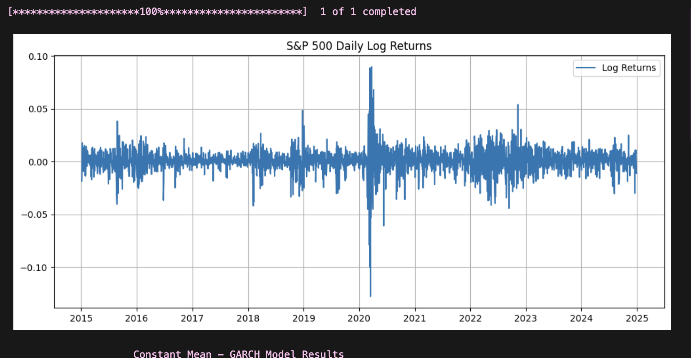
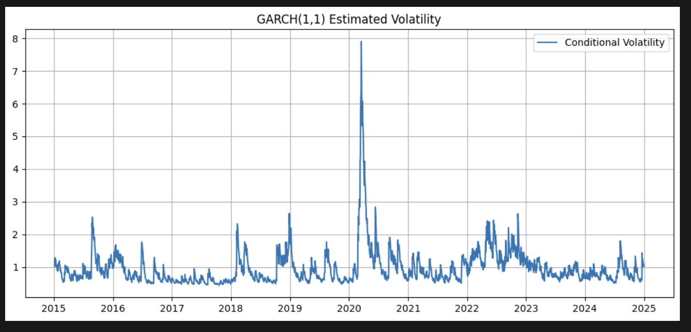

# Volatility Modeling with ARCH/GARCH

This project demonstrates how to model time-varying volatility in financial returns using ARCH and GARCH models. The dataset used is the S&P 500 index (`^GSPC`) from Yahoo Finance.

## Project Structure

```
volatility-modeling/
├── .venv/                  # Python virtual environment
├── data/                  # Folder for storing downloaded data
├── notebooks/             # Jupyter notebooks
│   └── arch_garch_model.ipynb
├── outputs/               # Plots or generated model outputs
├── test_imports.py        # Test for library imports
├── requirements.txt       # Installed Python packages
└── README.md              # Project overview
```

## How to Run

1. Clone the repo and navigate to the folder.
2. Create a virtual environment:
   ```
   python3 -m venv .venv
   source .venv/bin/activate
   ```
3. Install dependencies:
   ```
   pip install -r requirements.txt
   ```
4. Launch the notebook:
   ```
   jupyter notebook notebooks/arch_garch_model.ipynb
   ```

## Key Tools

- Python
- `arch` for GARCH models
- `yfinance` for market data
- `matplotlib` for visualization

## Output

- Estimated conditional volatility from a GARCH(1,1) model
- Comparison with raw return series


## 📈 Sample Outputs

### Log Returns Time Series


### Model Summary Table


### GARCH(1,1) Estimated Volatility


## 👤 Author

Amanda Achiangia  
BSc Applied Mathematics (Financial Mathematics), York University  
Aspiring Quantitative Finance Professional  
[LinkedIn](https://www.linkedin.com/in/YOUR-LINKEDIN/) | [GitHub](https://github.com/sensor-aae)

