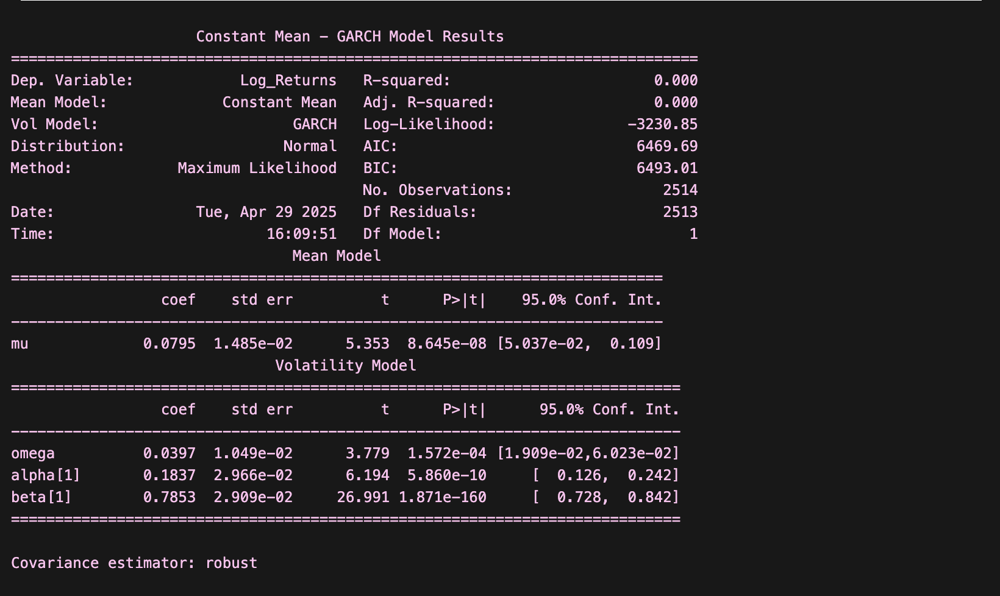

# Volatility Modeling with ARCH/GARCH
 
**GARCH(1,1) conditional volatility estimation on S&P 500 returns**
 


 
---
 
## Overview
 
This project fits a **GARCH(1,1) model** to S&P 500 daily log-returns using MLE via the `arch` library, producing time-varying conditional volatility estimates.
 
It serves two purposes:
 
1. **Standalone analysis** — demonstrating that volatility is not constant and that ARCH-family models significantly improve on the constant-variance assumption
2. **Foundation for the Integrated Risk App** — the MLE estimation methodology and GARCH parameter interpretation developed here directly inform the `garch_mle.py` module in [Integrated-Risk-App](https://github.com/sensor-aae/Integrated-Risk-App), which upgrades the FHS (Filtered Historical Simulation) VaR model from fixed parameters to MLE-estimated ones
---
 
## Connection to Integrated-Risk-App
 
The `Integrated-Risk-App` risk engine uses a GARCH(1,1) volatility filter to implement **Filtered Historical Simulation (FHS) VaR** — a methodology that standardises historical returns by their conditional volatility before computing quantiles.
 
The original implementation used hardcoded parameters (α=0.05, β=0.94), which is a documented limitation. The `garch_mle.py` module in that repo closes this gap by implementing MLE estimation consistent with what is demonstrated here.
 
**Relationship between the two repos:**
 
| This repo (`Volatility-modeling`) | Integrated-Risk-App |
|---|---|
| Fits GARCH(1,1) via `arch` library MLE | Implements GARCH MLE via `scipy.optimize` (no extra dependency) |
| Single-asset (S&P 500) | Multi-asset portfolio |
| Estimation and diagnostics focus | Risk measure application (VaR, ES, backtesting) |
| Jupyter notebook | Production Python package |
 
---
 
## Key Findings
 
**Volatility clustering is strongly present**
The GARCH(1,1) model captures high persistence in S&P 500 return volatility, with α+β close to 1 — consistent with the well-documented behaviour of equity return series. This means volatility shocks dissipate slowly, and periods of elevated volatility tend to follow one another.
 
**MLE-estimated parameters materially differ from common fixed defaults**
The `arch` library MLE estimates produce α and β values that are data-specific. Using fixed defaults (e.g. α=0.05, β=0.94, commonly seen in textbooks and RiskMetrics) can introduce meaningful misspecification, particularly for assets with atypical volatility dynamics.
 
**Conditional volatility provides better VaR inputs than unconditional volatility**
Rescaling historical returns by their GARCH-estimated conditional volatility before taking quantiles (Filtered Historical Simulation) produces VaR estimates that adapt to the current volatility regime — more conservative when vol is elevated, less so in calm periods. This directly addresses the main weakness of plain historical simulation.
 
---
 
## Project Structure
 
```
volatility-modeling/
├── notebooks/
│   └── arch_garch_model.ipynb   # Main analysis notebook
├── outputs/
│   ├── log_returns_plot.png
│   ├── summary_table.png
│   └── estimated_volatility.png
├── test_imports.py
├── requirements.txt
└── README.md
```
 
---
 
## Sample Outputs
 
### Log Returns — S&P 500
 

 
### GARCH(1,1) Model Summary
 

 
### Estimated Conditional Volatility
 

 
---
 
## How to Run
 
```bash
git clone https://github.com/sensor-aae/Volatility-modeling.git
cd Volatility-modeling
 
python3 -m venv .venv
source .venv/bin/activate
 
pip install -r requirements.txt
jupyter notebook notebooks/arch_garch_model.ipynb
```
 
---
 
## Tech Stack
 
| Library | Purpose |
|---|---|
| `arch` | GARCH model estimation (MLE) |
| `yfinance` | S&P 500 price data |
| `pandas` / `numpy` | Data handling |
| `matplotlib` | Visualisation |
 
---
 
## Related Projects
 
- **[Integrated-Risk-App](https://github.com/sensor-aae/Integrated-Risk-App)** — Full market & credit risk engine (VaR, ES, backtesting, stress testing) that uses GARCH-estimated volatility for FHS VaR
---
 
## Author
 
Amanda Achiangia
BSc Applied Mathematics (Financial Mathematics), York University
[LinkedIn](https://www.linkedin.com/in/amanda-a-602328284/) | [GitHub](https://github.com/sensor-aae)
 
